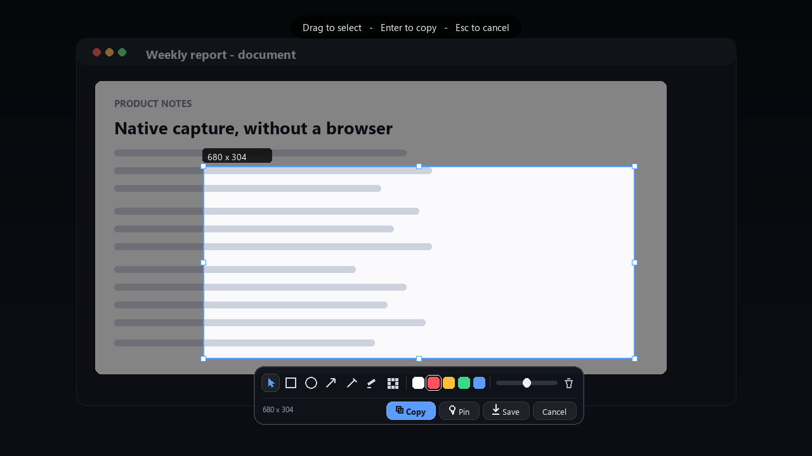
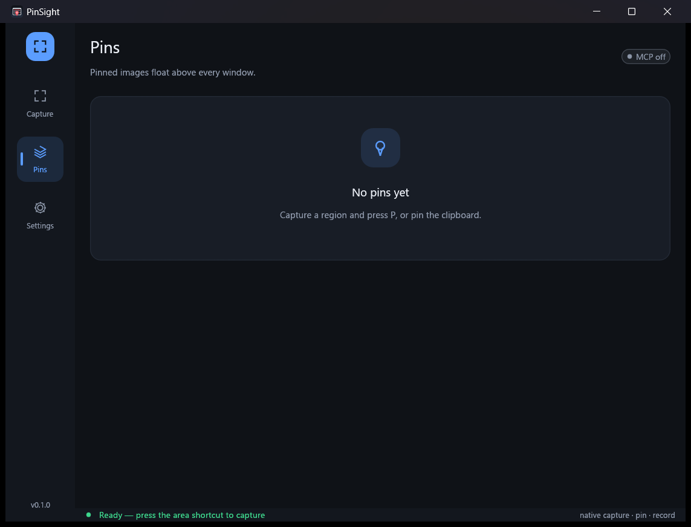
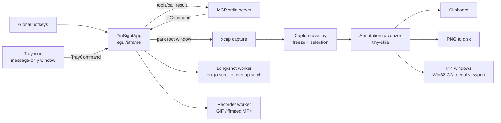

<div align="center">
  
  <h1>PinSight</h1>
  <p><strong>原生 Rust 截图 · 标注 · 贴图 · 长截图 · 录屏，内置 MCP 服务，无 WebView。</strong></p>

  <p>
    
    
    
    
  </p>

  <p>
    <a href="#快速开始">快速开始</a> ·
    <a href="#界面">界面与本地化</a> ·
    <a href="#mcp-集成">MCP</a> ·
    <a href="#架构">架构</a> ·
    <a href="#roadmap">Roadmap</a>
  </p>
</div>



> **状态：v0.1.0 / 可用。** 截图、标注（文字 / 序号 / 撤销重做 / 马赛克 / 高亮）、贴图、
> 长截图、GIF/MP4 录屏、离线 OCR、GIF 编辑（裁剪 / 裁切 / 加文字 / 转 MP4）、图片上传、
> 语音便签、MCP、托盘菜单、自定义背景图与界面内热键录制均已跑通；长截图对固定页眉、
> 粘性元素与动画仍有一定敏感性。
> 界面支持深/浅色主题、5 种强调色、7 种语言与字体切换，设置页分多个标签并记住上次打开的位置。
> 项目使用原生 Win32 窗口与 GDI 绘制，不依赖 Electron、Tauri 或 WebView；
> 除 Windows 外也可在 macOS 与 Linux 上构建运行（贴图自动切换为 egui 视口实现）。

---

## 为什么是 PinSight

Snipaste 与 PixPin 证明了「截图 + 贴图」是极高频的桌面工作流，但它们的核心实现是闭源的。
PinSight 想做的是一个**可读、可改、可自动化**的开源实现：

- **纯原生**：UI 用 `egui/eframe`，贴图窗口是 Win32 `WS_POPUP`，位图用 GDI 绘制；没有浏览器内核。
- **性能优先**：截图走 `xcap`（Windows Graphics Capture / GDI 后端），标注在 Rust 侧用 `tiny-skia` 光栅化，录屏在独立线程逐帧编码。
- **为长期使用而设计**：主题、强调色、字号、界面语言、字体都可切换，控件与图标全部矢量手绘，不随缩放失真。
- **对 AI 友好**：内置 MCP stdio 服务，Claude Desktop、Cursor、Continue 等客户端可以直接调用截图、贴图、长截图、录屏能力。
- **工程透明**：模块边界、线程模型、坐标空间和失败模式都写在 [docs/ARCHITECTURE.md](docs/ARCHITECTURE.md)。

PinSight 仍在快速迭代：滚动长截图的边界情况（固定页眉、粘性元素、动画）与 Snipaste
可能仍有差距，macOS / Linux 上的贴图与 OCR 后端也仍在打磨中。核心能力（截图、标注、
贴图、长截图、录屏、OCR、GIF 编辑、上传、MCP）已可在 Windows 上日常使用。

---

## 功能

| 能力 | 状态 | 说明 |
| --- | --- | --- |
| 区域截图 | ✅ | 全局热键唤出冻结层，拖拽选区，支持边角/边线调整 |
| 全屏截图 | ✅ | 截取光标所在显示器并复制到剪贴板 |
| 标注 | ✅ | 矩形、椭圆、箭头、画笔、高亮、马赛克、序号标注、文字标注；颜色与线宽可调，`Ctrl+Z`/`Ctrl+Y` 撤销重做 |
| 贴图 | ✅ | Windows 为原生置顶无边框窗口，其他平台用 egui 视口；拖动、滚轮缩放、`Ctrl+滚轮` 透明度、点击穿透、中键/Esc 关闭；**右键菜单**可复制/另存为/缩放预设/置顶/穿透/关闭/销毁 |
| 剪贴板贴图 | ✅ | 一键把剪贴板图片钉在屏幕上 |
| 长截图 | 🧪 | 选区后自动滚轮+逐帧捕获+重叠区拼接；适合静态、无固定表头的内容 |
| 录屏 | ✅ | 选区逐帧捕获；安装 `ffmpeg` 时输出 MP4，否则输出 GIF |
| 全局热键 | ✅ | 6 个动作均可在设置页内「录制」自定义（点 Record 后按组合键，Esc 取消），即时生效；注册失败会标红并说明原因 |
| 命令行 | ✅ | `pinsight shot` 无窗口截图（scrot/maim 风格）：`--region` / `--monitor` / `--out` / `--clipboard` / `--delay` |
| 单实例 | ✅ | 重复启动不会注册第二套热键，而是唤起已在运行的实例（Windows 命名互斥量，其他平台锁文件 + PID 存活检测） |
| 托盘菜单 | ✅ | 任务栏图标 + 本地化右键菜单（含各项快捷键提示），Explorer 重启后自动恢复 |
| 自定义背景 | ✅ | 主窗口背景图：文件选择、高斯模糊、压暗 veil、cover/contain/stretch 三种适配 |
| 开机自启 | ✅ | Windows 注册表 / Linux `.desktop` / macOS LaunchAgent，设置页一键开关 |
| 便携模式 | ✅ | `--portable` 或 `pinsight.portable` 标记文件：配置与截图全部落在安装目录内 |
| MCP | ✅ | `--mcp` 启动 stdio 服务，暴露 9 个工具 |
| 主题 | ✅ | 跟随系统 / 浅色 / 深色，5 种强调色，即时生效 |
| 多语言 | ✅ | 简体中文、繁體中文、English、日本語、한국어、Français、Deutsch |
| 字体 | ✅ | 自动匹配系统语言字体，或指定无衬线 / 衬线 / 等宽 / 自定义字体文件，字号 85%–135% 可调 |
| 配置持久化 | ✅ | JSON 配置，外观改动即时写回；设置页标签位置也会记住 |
| 文本标注 / OCR | ⏳ | 计划中 |
| 单实例 | ⏳ | 计划中（当前重复启动会产生多个进程） |

---

## 界面

主窗口由左侧图标导航 + 内容区 + 状态栏组成，所有控件（磁贴、分段控件、色板、开关、图标）
都用 `egui::Painter` 手绘，不依赖图片素材，因此能随 DPI、主题和字号无损缩放。

| 主界面 | 设置 |
| --- | --- |
|  |  |
|  |  |

### 主题

- **跟随系统**（默认）/ **浅色** / **深色**，切换即时生效并写回配置。
- **5 种强调色**：蓝、紫、翡翠、琥珀、玫红。强调色同时决定选中态、主按钮、选区描边和贴图卡片高亮。
- 冻结层与工具栏始终使用暗色玻璃质感，保证在任意桌面背景上都有足够对比度。

### 多语言

支持 7 种语言，首次启动按 Windows 界面语言自动选择：

| 语言 | 代码 |
| --- | --- |
| 简体中文 | `zh-hans` |
| 繁體中文 | `zh-hant` |
| English | `en` |
| 日本語 | `ja` |
| 한국어 | `ko` |
| Français | `fr` |
| Deutsch | `de` |

全部文案集中在 [`src/i18n.rs`](src/i18n.rs) 的一张表里，新增语言只需加一列；
`strings!` 宏会把它展开成 `&'static str` 结构体，**漏翻会在编译期报错**而不是运行时空字符串。

### 字体

- **自动**：按当前界面语言挑选系统字体（简中 → 微软雅黑、繁中 → 微軟 JhengHei、
  日文 → Yu Gothic、韩文 → Malgun Gothic…），并追加 CJK 回退字体，避免豆腐块。
- **无衬线 / 衬线 / 等宽**：从系统字体目录中挑选最合适的候选。
- **自定义**：填入任意 `.ttf` / `.otf` / `.ttc` 路径（例如思源黑体）。
- **字号**：85%–135% 缩放，影响全部文本样式（标题、正文、快捷键徽章）。

设置页底部会显示实际解析到的字体组合，例如 `字体: Microsoft YaHei + Microsoft JhengHei`，
方便排查"为什么看起来没变"。

### 托盘与背景

- **托盘**：Windows 任务栏常驻图标，右键菜单包含区域截图、全屏、剪贴板贴图、长截图、
  录屏、保存最近、显示主窗口、退出，每一项后面都跟着当前快捷键。Explorer 崩溃重启后
  图标会自动重新注册。关闭主窗口默认是"藏到托盘"而不是退出（`close_to_tray`），
  托盘里的"退出"才是真正结束进程。
- **背景**：主窗口可以换成任意图片（`png/jpg/webp/bmp`），带高斯模糊、压暗和
  cover / contain / stretch 三种适配方式；换图、调模糊、调暗度都即时生效并写回配置。

---

## 快速开始

### 环境要求

- Windows 10 / 11（x64）功能最全；macOS 与 Linux 可构建运行（贴图切换为 egui 视口，
  托盘、长截图滚轮模拟等为平台能力裁剪后的行为）
- Rust **1.85+**（edition 2024）
- 可选：`ffmpeg` 在 `PATH` 中，用于 MP4 录屏；否则自动回退到 GIF
- 可选（仅打包 installer 需要）：Inno Setup 6（`iscc`）

### 构建与运行

```powershell
git clone https://github.com/your-org/PinSight.git
cd PinSight

# 开发运行
cargo run

# 发布构建
cargo build --release
.\target\release\pinsight.exe
```

启动后主窗口会显示热键注册状态。按下 **`Ctrl+Shift+A`** 开始区域截图。

> 首次运行会在 `%APPDATA%\PinSight\config.json` 写入默认配置，并在
> `%USERPROFILE%\Pictures\PinSight` 创建输出目录。
> 便携模式下两者都改为安装目录下的 `data\` 与 `captures\`，不写注册表、不碰 `%APPDATA%`。

### 最小使用流程

1. `Ctrl+Shift+A` → 屏幕冻结、出现选区覆盖层。
2. 拖拽框选；按 `R/E/A/D/H/M` 切换标注工具（`V` 回到选择）。
3. `Enter` 复制到剪贴板，`P` 贴图，`Ctrl+S` 保存 PNG，`Esc` 取消。
4. 贴图窗口：左键拖动，滚轮缩放，`Ctrl+滚轮` 调透明度，中键或 `Esc` 关闭；
   主窗口的 Pin 列表可以切换点击穿透、复制、保存、关闭。

### 命令行截图（scrot / maim 风格）

不开窗口、不建 GL 上下文，适合脚本、远程会话和没有托盘的 Linux 桌面：

```text
pinsight shot                              # 整屏 → 保存目录，stdout 打印路径
pinsight shot --out shot.png               # 整屏 → 指定文件
pinsight shot --region 100,100,640,480     # 物理像素矩形
pinsight shot --monitor 65537 --out m.png  # 指定显示器
pinsight shot --clipboard                  # 只进剪贴板
pinsight shot --delay 3 --out s.png        # 3 秒后截
pinsight shot --list-monitors              # 列出显示器 id 与几何
```

约定与 `maim` 一致：`stdout` 只输出一行绝对路径（方便 `$(...)` 取用），
错误写 `stderr` 并以非零码退出。`--clipboard` 可与 `--out` 同时使用。

### 安装与打包

```powershell
# 一条命令产出便携 zip + 安装包（dist\ 下）
powershell -ExecutionPolicy Bypass -File scripts\package.ps1

# 没有 Inno Setup 时只出便携包
powershell -ExecutionPolicy Bypass -File scripts\package.ps1 -SkipInstaller

# UPX 压缩版：便携 zip 和安装包都用压缩后的 exe（7.2 MiB → 2.5 MiB）
# 需要 upx 在 PATH 上；可能触发杀软误报，所以默认关闭
powershell -ExecutionPolicy Bypass -File scripts\package.ps1 -Upx
```

只重打包（不重新编译），一次产出普通版 + UPX 版：

```bash
python tools/_repackage_portable.py                        # 两个包都出
PINSIGHT_UPX_ONLY=1 python tools/_repackage_portable.py    # 只出 UPX 版
```

- **安装版**（`dist\PinSight-<version>-setup.exe`）：Inno Setup 6 构建，
  **安装目录由用户自选**（默认 `%LOCALAPPDATA%\Programs\PinSight`），可选创建桌面图标、
  可选开机自启；卸载走系统"添加或删除程序"。
- **便携版**（`dist\PinSight-<version>-portable.zip`）：解压即用，文件夹里自带
  `pinsight.portable` 标记文件——程序检测到它就把配置、背景图、截图全部放在
  本目录的 `data\` / `captures\` 里，整个文件夹可以随意拷贝/删除，不在系统里留痕迹。
  删除该标记文件即可恢复为"按用户安装"行为。
- 也可以手动触发便携模式：`pinsight.exe --portable` 或环境变量 `PINSIGHT_PORTABLE=1`。
- CI 在打 `v*` 标签时自动为 Windows / macOS / Linux 三平台构建发布包。

---

## 快捷键

默认值（全部可在配置文件中修改）：

| 快捷键 | 动作 |
| --- | --- |
| `Ctrl+Shift+A` | 区域截图 + 标注 |
| `Ctrl+Shift+F` | 全屏截图并复制 |
| `Ctrl+Shift+V` | 把剪贴板图片贴到屏幕 |
| `Ctrl+Shift+L` | 长截图（再次按下取消） |
| `Ctrl+Shift+R` | 开始 / 停止选区录屏 |
| `Ctrl+Shift+S` | 保存最近一次截图 |

> 早期版本使用 `Ctrl+Alt+*`，实测与 Snipaste / QQ / 微信的截图快捷键冲突，因此改为
> `Ctrl+Shift+*`。如果你的系统仍冲突，启动时主窗口会列出不可用的组合。

全部 6 个组合都可以在**设置页 → 快捷键**里直接重新录制：点某一行的 `Record`，
然后按下新的组合键（需要至少一个修饰键，`Esc` 取消）。录制成功后立即重新注册，
无需重启；被其他程序占用的组合会标红并说明原因。

### 覆盖层内快捷键

| 按键 | 动作 |
| --- | --- |
| `V` | 选择/移动选区 |
| `R` / `E` / `A` / `D` / `H` / `M` / `N` / `T` | 矩形 / 椭圆 / 箭头 / 画笔 / 高亮 / 马赛克 / 序号标注 / 文字 |
| `Ctrl+Z` | 撤销上一个标注 |
| `Ctrl+Y` | 重做（`Ctrl+Shift+Z` 同样有效，但部分输入法会占用该组合） |
| `Enter` | 确认默认动作（复制或开始长截图/录屏） |
| `P` | 贴图 |
| `Ctrl+S` | 保存 PNG |
| `Ctrl+C` | 复制 |
| `Backspace` / `Delete` | 删除最后一个标注 |
| `Esc` | 取消 |

序号标注（`N`）点击即放置，编号按点击顺序自动递增（1、2、3…），
颜色跟随当前色板，可以用撤销回退。

文字标注（`T`）点击后出现内联输入框，输入完成按 `Enter` 放置、`Esc` 取消；
字号跟随工具栏的线宽滑块，颜色跟随色板。落盘时用与界面相同的字体文件轮廓化，
预览与最终 PNG 一致。

---

## MCP 集成

### 启动

MCP 服务与 GUI 在同一个进程中运行，使用 **stdio** 传输：

```powershell
.\target\release\pinsight.exe --mcp
```

日志写 stderr，stdout 只输出 JSON-RPC，符合 MCP stdio 约定。

### Claude Desktop

编辑 `claude_desktop_config.json`：

```json
{
  "mcpServers": {
    "pinsight": {
      "command": "D:\\path\\to\\PinSight\\target\\release\\pinsight.exe",
      "args": ["--mcp"]
    }
  }
}
```

### Cursor

项目根目录 `.cursor/mcp.json`：

```json
{
  "mcpServers": {
    "pinsight": {
      "command": "D:\\path\\to\\PinSight\\target\\release\\pinsight.exe",
      "args": ["--mcp"]
    }
  }
}
```

### 工具列表

| 工具 | 参数 | 作用 |
| --- | --- | --- |
| `capture_screenshot` | `monitor_id?`, `save?`, `return_base64?` | 截取整个显示器；调用时会先把主窗口移出画面 |
| `capture_region` | `x`, `y`, `width`, `height`, `save?`, `return_base64?` | 截取物理桌面矩形 |
| `pin_image` | `path` 或 `base64` | 贴一张本地/内联图片 |
| `list_pins` | — | 列出当前贴图 |
| `close_pin` | `id` | 关闭指定贴图 |
| `start_recording` | `monitor_id?`, `x?`, `y?`, `width?`, `height?`, `fps?` | 开始录屏 |
| `stop_recording` | — | 停止并返回文件路径 |
| `long_screenshot` | `monitor_id?`, `x?`, `y?`, `width?`, `height?`, `max_height?` | 滚动截长图并保存 |
| `get_status` | — | 版本、贴图数、录制状态、输出目录 |

示例（JSON-RPC）：

```json
{"jsonrpc":"2.0","id":1,"method":"tools/call",
 "params":{"name":"capture_region",
           "arguments":{"x":100,"y":100,"width":640,"height":480}}}
```

MCP 的坐标使用**物理像素**。多显示器、混合缩放时，建议先用
`capture_screenshot` 或 `get_status` 确认显示器信息。

---

## 配置

配置文件路径：

```text
%APPDATA%\PinSight\config.json
```

默认内容（也可参考 [`config.example.json`](config.example.json)）：

```json
{
  "hotkeys": {
    "capture_area": "Ctrl+Shift+A",
    "capture_full": "Ctrl+Shift+F",
    "pin_clipboard": "Ctrl+Shift+V",
    "long_capture": "Ctrl+Shift+L",
    "record": "Ctrl+Shift+R",
    "save_last": "Ctrl+Shift+S"
  },
  "save_dir": "C:\\Users\\you\\Pictures\\PinSight",
  "gif_fps": 12,
  "long_capture_max_height": 20000,
  "mcp_enabled": false,
  "theme": "system",
  "accent": "blue",
  "lang": "zh-hans",
  "font": "auto",
  "font_scale": 1.0,
  "font_path": null,
  "bg_image": null,
  "bg_blur": 12.0,
  "bg_dim": 0.45,
  "bg_fit": "cover",
  "close_to_tray": true,
  "run_at_startup": false,
  "settings_tab": "appearance"
}
```

- `gif_fps`：录屏帧率（4–30）。
- `long_capture_max_height`：长截图最大高度，防止内存失控。
- `mcp_enabled`：保留字段；是否启动 MCP 由 `--mcp` 决定。
- `theme`：`system` / `light` / `dark`。
- `accent`：`blue` / `violet` / `emerald` / `amber` / `rose`。
- `lang`：`zh-hans` / `zh-hant` / `en` / `ja` / `ko` / `fr` / `de`。
- `font`：`auto` / `sans` / `serif` / `mono` / `custom`；`custom` 时读取 `font_path`。
- `font_scale`：文本缩放，0.85–1.35。
- `bg_image`：主窗口背景图片路径，`null` 为纯色；`bg_blur` 为高斯模糊半径（px），
  `bg_dim` 为压暗强度（0–0.85），`bg_fit` 为 `cover` / `contain` / `stretch`。
- `close_to_tray`：关闭主窗口时藏到托盘而非退出（仅 Windows 默认开启）。
- `run_at_startup`：开机自启（Windows 注册表 / Linux autostart / macOS LaunchAgent）。
- `settings_tab`：设置页记住的标签，`appearance` / `output` / `hotkeys` / `about`。

外观相关的字段在设置页改动后立即写回，不需要重启。

---

## 架构



### 目录结构

```text
PinSight/
├── Cargo.toml
├── Cargo.lock
├── README.md
├── LICENSE
├── CONTRIBUTING.md
├── CHANGELOG.md
├── config.example.json
├── .github/
│   └── workflows/
│       ├── ci.yml                # Windows fmt / clippy / test / build
│       └── release.yml           # v* 标签：Windows / macOS / Linux 三平台发布包
├── assets/
│   ├── icon.png                  # 应用图标（多尺寸矢量导出）
│   ├── icon.ico                  # Windows 图标
│   └── tray.ico                  # 托盘图标（多分辨率）
├── docs/
│   ├── ARCHITECTURE.md          # 线程、坐标、数据流、失败模式
│   └── images/                  # demo / main / settings / pins 截图
├── packaging/
│   └── windows/
│       └── pinsight.iss          # Inno Setup 脚本（自选安装目录 / 开机自启任务）
├── scripts/
│   ├── package.ps1               # 产出便携 zip + 安装包
│   ├── make_assets.py            # 生成 icon 与 README 演示图
│   ├── make_icon.py              # 绘制应用/托盘图标
│   ├── measure.py                # 内存/CPU 采样脚本
│   ├── preview.py                # 驱动主窗口逐页截图（外观走查用）
│   ├── overlay_drag.py           # 唤出冻结层并拖出选区后截图
│   ├── pin_flow.py               # 端到端跑一遍 截图 → 贴图 → 贴图列表
│   ├── shot.py                   # PrintWindow 抓取单个窗口
│   ├── shot_ui.py                # 像素级 UI 自动化验收（点击/按键/找色）
│   ├── undo_probe.py             # 端到端验证撤销/重做（像素计数）
│   └── number_probe.py           # 端到端验证序号标注（圆盘+数字检测）
├── src/
│   ├── main.rs                   # CLI、日志、eframe 启动、窗口图标
│   ├── app.rs                    # 应用状态机、页面、主窗口、捕获流程编排
│   ├── ui.rs                     # 手绘控件与矢量图标集（24×24 网格）
│   ├── theme.rs                  # 调色板、控件样式、字号阶梯
│   ├── fonts.rs                  # 系统字体发现与语言匹配
│   ├── i18n.rs                   # 7 种语言的文案表与语言检测
│   ├── capture.rs                # 显示器枚举 / 全屏 / 物理矩形抓取
│   ├── overlay.rs                # 冻结层、选区、工具栏、快捷键
│   ├── annotate.rs               # 标注模型、预览、tiny-skia 光栅化
│   ├── pin.rs                    # Windows 原生贴图窗口（Win32 消息循环 + GDI）
│   ├── pin_viewport.rs           # 其他平台的贴图（egui 视口实现）
│   ├── longshot.rs               # 滚动捕获、重叠检测、拼接
│   ├── record.rs                 # 录屏线程、GIF 编码、ffmpeg MP4
│   ├── hotkeys.rs                # 全局热键注册、解析、冲突分类、热更新
│   ├── tray.rs                   # Windows 托盘图标、消息窗口与右键菜单
│   ├── startup.rs                # 开机自启（注册表 / autostart / LaunchAgent）
│   ├── single_instance.rs        # 单实例：命名互斥量 / 锁文件，二次启动唤起已有实例
│   ├── background.rs             # 自定义背景图：解码、模糊、适配、纹理
│   ├── mcp.rs                    # 手写 MCP stdio server + 工具定义
│   ├── config.rs                 # JSON 配置读写、便携模式路径解析
│   └── util.rs                   # 时间戳、PNG、剪贴板、路径工具
└── .gitignore
```

### 技术栈

| 层 | 选型 | 理由 |
| --- | --- | --- |
| GUI | `egui` + `eframe`（glow） | 纯 Rust、立即模式、无 WebView、编译快 |
| 控件与图标 | 自绘（`egui::Painter`） | 主题/字号/DPI 变化时无损缩放，不依赖图片素材 |
| 字体 | `FontDefinitions` + 系统字体扫描 | 按语言挑主字体并追加 CJK 回退，避免豆腐块 |
| 屏幕捕获 | `xcap` | 多显示器、区域捕获、Windows 原生后端 |
| 标注光栅化 | `tiny-skia` | CPU 抗锯齿路径，输出稳定，无 GPU 依赖 |
| 贴图窗口 | Win32 `WS_POPUP` + GDI（Windows）/ egui 视口（其他平台） | Windows 上真正常驻置顶、无边框、可点击穿透；其他平台用视口保持同一套交互 |
| 滚动模拟 | `enigo` | 发送鼠标滚轮 |
| 全局热键 | `global-hotkey` | Windows RegisterHotKey 封装；改键时复用同一 manager 热更新 |
| 托盘 | `windows` crate（`Shell_NotifyIconW` + message-only 窗口） | 消息窗口挂在 UI 线程，winit 的消息泵顺带派发，无需额外线程 |
| 文件选择 | `rfd` | 跨平台原生对话框（IFileOpenDialog / NSOpenPanel / zenity），非 WebView |
| 录屏 | `gif` + 可选 `ffmpeg` | 零外部依赖的 GIF；有 ffmpeg 时输出 MP4 |
| MCP | 手写 JSON-RPC stdio | 避免 async runtime 与 SDK 版本绑定，协议可控 |
| 剪贴板 | `arboard` | 图片剪贴板支持 |
| 日志 | `tracing` + `tracing-subscriber` | stderr 日志，不污染 MCP stdout |

---

## 设计取舍

### 为什么不用 Tauri / React

Tauri 的 UI 层就是 WebView。截图工具最敏感的路径是**冻结层标注**与**贴图窗口响应**，
把这两块交给 WebView 会引入合成延迟、跨窗口状态同步和更高的内存占用。PinSight 选择
`egui` 做控制面板与覆盖层，贴图则直接使用 Win32 窗口，整条链路保持原生。

### 为什么贴图不用 egui 子窗口

`egui` 的 immediate/deferred viewport 适合临时窗口，但在实测中，长期存在的无边框贴图
窗口在纹理上传和重绘调度上不够稳定。PinSight 改为每个贴图一个 Win32 消息循环线程，
用 GDI `StretchDIBits` 直接呈现位图：置顶、拖动、缩放、透明度和点击穿透都由系统窗口
管理器处理，行为可预测。

### 截图时如何避免截到自己

主窗口不能简单 `hide()`：隐藏后 eframe 不再运行 UI pass，覆盖层也无法渲染。PinSight
的做法是把主窗口移到虚拟桌面之外（`-10000, -10000`，而不是 Windows 会当成最小化的
`-32000`），等待约 140ms 再抓屏，随后恢复位置与焦点。

### 性能与内存

发布构建（Windows 11 / 125% 缩放 / 简体中文界面）实测：

| 指标 | 数值 | 备注 |
| --- | --- | --- |
| 空闲工作集（任务管理器「内存」列） | **≈ 5 MB** | 启动 8 秒后与最小化到托盘时调用 `SetProcessWorkingSetSize` 把页面交还系统；下次交互按需缺页调回（几毫秒） |
| 空闲私有提交 | **≈ 47 MB** | 其中 **≈ 46 MB 是 egui/eframe/glow + Intel WGL 驱动的空窗底噪**：实测一个只有 `ui.label("hello")` 的 eframe 程序就是 47.8 MB 私有，PinSight 自身只多约 1–2 MB |
| 启动后未修剪时的工作集 | ≈ 89 MB | 含可共享的代码页与 GL 驱动映射 |
| 空闲 CPU | **0.2%** 单核 | `ControlFlow::Wait`，无输入时不重绘 |
| 启动 CPU | ≈ 0.6 s | 字体解析 + 图标图集栅格化 |

> **为什么不是 9 MB**：WebView2 类工具（DBX 等）把渲染器放在系统共享运行时里，
> 进程私有字节自然很小；egui + OpenGL 必须在进程内自带上下文与驱动分配。
> 这是选型决定的固定成本，不是应用层的浪费——上面的底噪测量就是为了把这一点量化：
> 即使砍掉 PinSight 的全部功能也只能降到约 48 MB。要做到个位数内存，只能换掉整个 UI 栈。
> 在这个约束内已经做了能做的：字体内存映射（不占私有提交）、按需 CJK 回退、
> LTO + 单 codegen unit + 剥离符号、录屏增量落盘、长截图硬上限。

几个关键的省内存设计：

- **按需加载 CJK 回退字体**：主字体已覆盖 CJK 时不再加载第二个 20MB 字体；
  确需加载时用**内存映射**而非堆拷贝，页面由页面缓存支撑、可被回收。
- **发布产物瘦身**：fat LTO + 单 codegen unit + 剥离符号，可执行文件约 8.6 MB。
- **逐帧增量落盘**：录屏边捕获边写，内存不随时长增长。
- **长截图有硬上限**：`long_capture_max_height`（默认 20000px）与 80 帧封顶，
  防止拼接结果失控。

复现方式：

```powershell
python scripts\measure.py 6
```

### 长截图的拼接

1. `enigo` 把光标移到选区中心并滚动若干格。
2. 等待动画稳定后抓取同一区域。
3. 在 `[h/8, 0.9h]` 范围内搜索上下帧的重叠高度，对 RGB 采样做平均绝对差。
4. 取差异最小的候选；差异过大则停止，避免把错位内容拼进去。
5. 追加新行，直到达到 `max_height` 或页面不再移动。

固定表头、悬浮按钮、滚动条和动画会破坏重叠匹配，因此长截图目前标记为实验性。

---

## 已知限制

- **平台差异**：贴图在 Windows 用原生 Win32 窗口，macOS / Linux 自动切换为 egui 视口实现，
  交互一致但系统级行为（如真点击穿透）以平台能力为准；托盘图标目前仅 Windows。
- **长截图**：不适合含固定侧栏/表头、无限滚动、强动画的页面；默认最多 80 帧 / 20000px。
- **录屏**：帧率受捕获速度限制；GIF 体积较大；MP4 需要 `ffmpeg`。
- **标注**：暂不支持文字、序号、模糊以外的撤销/重做栈（马赛克已支持）。
- **混合 DPI 多显示器**：覆盖层用显示器逻辑坐标定位，极端缩放组合下可能需要微调。
- **热键冲突**：`global-hotkey` 注册失败时，设置页会把该组合标红并写明"已被其他程序占用"，
  不会自动改键；点 `Record` 换一个组合即可，无需重启。
- **单实例**：已实现；重复启动会唤起已有实例后退出。非 Windows 平台的"唤起"能力有限
  （无法直接操作其他进程的窗口），第二次启动只会安静退出。
- **MCP 截图**：会把 PinSight 主窗口移出画面，但已存在的贴图窗口仍可能出现在截图中。

---

## Roadmap

- [ ] 文本标注（需要文字排版与光标编辑，序号标注已用矢量数字实现）
- [ ] 标注图层管理
- [x] 撤销 / 重做（`Ctrl+Z` / `Ctrl+Y`，快照式历史）
- [x] 序号标注（`N`，七段矢量数字，自动递增）
- [x] 单实例（命名互斥量 / 锁文件，二次启动唤起已有实例）
- [ ] 滚动条感知的长截图；固定表头裁剪
- [ ] OCR（Windows OCR / Tesseract）与 MCP `ocr_image`
- [ ] 贴图旋转、阴影、吸附对齐
- [ ] 多显示器混合 DPI 校准
- [ ] macOS / Linux 托盘与安装包（.dmg / .deb / AppImage）
- [x] 主题（跟随系统 / 浅色 / 深色）、强调色、字号
- [x] 国际化：简中 / 繁中 / 英 / 日 / 韩 / 法 / 德
- [x] 字体选择与 CJK 回退
- [x] Windows 托盘图标与本地化右键菜单
- [x] 界面内热键录制与自定义（即时生效）
- [x] 自定义主窗口背景图（模糊 / 压暗 / 适配）
- [x] 开机自启（三平台）
- [x] 便携模式与自选目录的安装包
- [ ] 更多语言（西 / 葡 / 俄）与社区翻译流程

---

## 开发

```powershell
cargo fmt --all
cargo clippy --all-targets
cargo test
cargo build --release
```

单元测试覆盖：

- 热键字符串解析与非法输入
- 长截图重叠检测与拼接
- 标注光栅化与马赛克
- 背景图适配（cover / contain / stretch）与压暗计算
- 开机自启路径构造
- 7 种语言文案表完整性（漏翻即编译失败，测试兜底字段数量）

日志：

```powershell
$env:RUST_LOG = "pinsight=debug"
cargo run
```

MCP 模式日志固定写 stderr：

```powershell
.\target\release\pinsight.exe --mcp 2> mcp.log
```

更细的线程模型与坐标约定见 [docs/ARCHITECTURE.md](docs/ARCHITECTURE.md)。

---

## 贡献

欢迎 Issue 与 PR。提交前请：

1. 运行 `cargo fmt --all` 与 `cargo test`。
2. 说明复现步骤、Windows 版本、显示器缩放比例。
3. 涉及 UI 的改动请附截图或录屏。

详见 [CONTRIBUTING.md](CONTRIBUTING.md)。

## License

[Apache-2.0](LICENSE) © 2026 PinSight contributors

## 致谢

- [egui / eframe](https://github.com/emilk/egui)
- [xcap](https://github.com/nashaofu/xcap)
- [tiny-skia](https://github.com/RazrFalcon/tiny-skia)
- [global-hotkey](https://github.com/tauri-apps/global-hotkey)
- [enigo](https://github.com/enigo-rs/enigo)
- [arboard](https://github.com/1Password/arboard)
- Snipaste 与 PixPin：证明了这个小工具值得被认真做
