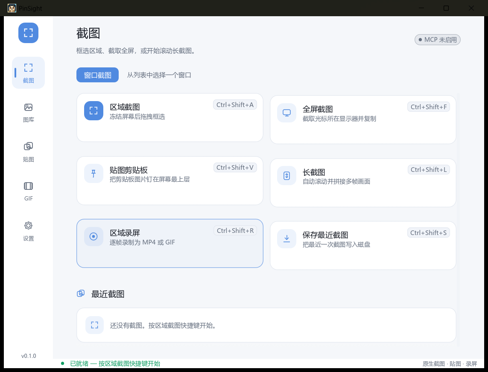
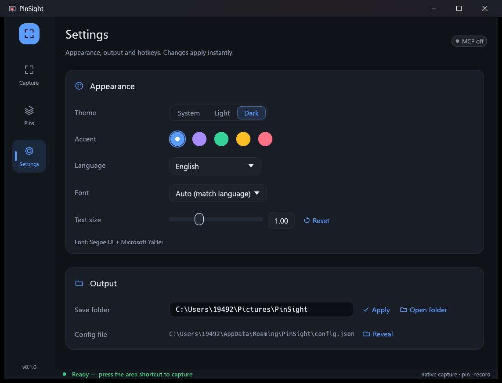
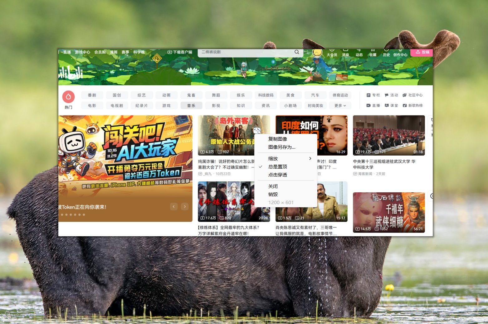
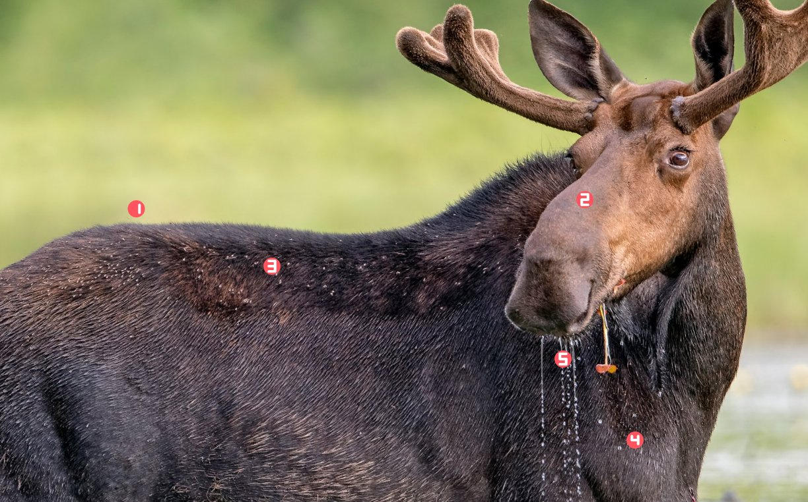
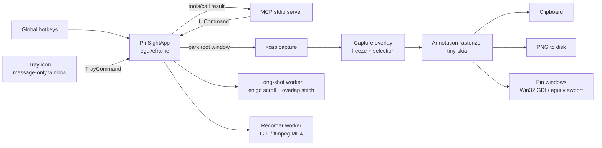

<div align="center">


# PinSight

</div>

<hr />

<div align="center">

**Native Rust screenshot · annotate · pin · long-capture · record · OCR · GIF edit · upload, with a built-in MCP server. No WebView.**

<br />

[](https://github.com/yiqiui/PinSight/releases)
[](https://github.com/yiqiui/PinSight/stargazers)
[](LICENSE)
[](https://github.com/yiqiui/PinSight/blob/main/README_EN.md#mcp-integration)
[](https://www.rust-lang.org)

[](https://github.com/yiqiui/PinSight/releases)
[](https://github.com/yiqiui/PinSight/releases)
[](https://github.com/yiqiui/PinSight/releases)

[Quick start](#quick-start) · [UI](#user-interface) · [MCP](#mcp-integration) · [Architecture](#architecture) · [Roadmap](#roadmap)

[English](README_EN.md) · [简体中文](README.md)

</div>

<br />

<div align="center">
  
</div>

> **Status: v0.1.0 / usable.** Capture, annotation (text / numbered steps / undo-redo / mosaic / highlight), pin-to-screen, long capture, GIF/MP4 recording, offline OCR, GIF editing (trim / crop / add text / convert to MP4), image upload, voice notes (recording works; click-to-play pending), MCP, tray menu, custom background and in-app hotkey recording all work. Long capture is still sensitive to sticky headers and animations.
> The UI ships dark/light themes, 6 accent colours, 7 languages and font switching; the settings window has multiple tabs and remembers where you left off.
> PinSight draws with native Win32 windows and GDI — no Electron, no Tauri, no WebView. It also builds and runs on macOS and Linux (pins fall back to an egui viewport).

---

## Why PinSight

Snipaste and PixPin proved that "screenshot + pin" is a high-frequency desktop workflow, but their cores are closed source. PinSight aims to be an open implementation that is **readable, hackable and automatable**:

- **Purely native**: the UI is `egui/eframe`, pin windows are Win32 `WS_POPUP` with GDI bitmaps; no browser engine anywhere.
- **Performance first**: capture goes through `xcap` (Windows Graphics Capture / GDI backends), annotations are rasterised in Rust with `tiny-skia`, recording encodes frame-by-frame on its own thread.
- **Built for daily long-term use**: theme, accent, font size, UI language and fonts are all switchable; every widget and icon is hand-drawn vectors that never blur when scaled.
- **AI friendly**: a built-in MCP stdio server lets clients such as Claude Desktop, Cursor or Continue call capture, pin, long-capture and recording tools directly.
- **Engineering transparency**: module boundaries, threading model, coordinate spaces and failure modes are documented in [docs/ARCHITECTURE.md](docs/ARCHITECTURE.md).
- **The owl logo**: the owl's face **is a screenshot selection** — a rounded-rectangle face framed by four viewfinder brackets (amber left pair, cyan right pair), a focus-cross left eye and a dot right eye. No round head, no ear tufts, no wings: "the region being captured" is the owl, echoing the focus-ring handles on the selection corners and the wing-fold entrance of the freeze overlay. Both eye colours are accent presets. The icon is generated by [`scripts/make_owl_icon.py`](scripts/make_owl_icon.py).

PinSight is still iterating quickly: edge cases of scrolling long capture (fixed headers, sticky elements, animations) may lag behind Snipaste, and the pin backends on macOS / Linux are still being polished. The core features (capture, annotate, pin, long capture, record, OCR, GIF editing, upload, MCP) are usable daily on Windows.

---

## Features

| Capability | Status | Notes |
| --- | --- | --- |
| Region capture | ✅ | Global hotkey summons a frozen-screen overlay; drag a selection with corner/edge handles |
| Fullscreen capture | ✅ | Grabs the monitor under the cursor and copies it |
| Annotation | ✅ | Rectangle, ellipse, arrow, pen, highlighter, mosaic, numbered steps, text; colour and stroke width adjustable, `Ctrl+Z`/`Ctrl+Y` undo/redo |
| Pin to screen | ✅ | Native always-on-top borderless window on Windows, egui viewport elsewhere; drag, wheel zoom, `Ctrl+wheel` opacity, click-through, middle/Esc to close; a **context menu** offers copy / save as / zoom presets / topmost / click-through / close / destroy |
| Pin from clipboard | ✅ | Pin whatever image is on the clipboard in one keystroke |
| Long capture | 🧪 | Automatic scrolling + frame stitching after selection; best on static pages without sticky headers |
| Screen recording | ✅ | Frame-by-frame capture of a region; MP4 when `ffmpeg` is installed, GIF otherwise |
| Offline OCR | ✅ | Windows uses the built-in `Windows.Media.Ocr`, macOS uses Vision, Linux uses Tesseract; one-click region OCR in the toolbar; CLI `pinsight shot --ocr` for full screen |
| Image upload | ✅ | Toolbar upload button + CLI `--upload`; defaults to a local backend writing into `<save dir>/uploaded/`, switchable to HTTP (POST/PUT, form or JSON responses) |
| Voice notes | 🧪 | Record screen notes with an audio track; click-to-play not closed yet (audio playback library pending) |
| Global hotkeys | ✅ | All 6 actions can be re-recorded in the settings window (press Record, then the combo; Esc cancels), effective instantly; conflicts are flagged in red with the reason |
| Command line | ✅ | Headless subcommands (scrot/maim style): `shot` capture, `pdf` bundle PDF, `gif` edit animated GIFs, `voice` voice notes — see below |
| Single instance | ✅ | Launching twice wakes the running instance instead of registering a second hotkey set (named mutex on Windows, lock file + PID check elsewhere) |
| Tray menu | ✅ | Taskbar icon with a localised context menu (hotkey hints included); re-registers itself after an Explorer restart |
| Custom background | ✅ | Main-window background image with Gaussian blur, dimming veil and cover/contain/stretch fitting |
| Run at startup | ✅ | Windows registry / Linux `.desktop` / macOS LaunchAgent, one toggle in settings |
| Portable mode | ✅ | `--portable` or a `pinsight.portable` marker file: config and captures stay inside the install folder |
| MCP | ✅ | `--mcp` starts the stdio server with 9 tools |
| Themes | ✅ | System / light / dark, 6 accent colours, instant |
| Languages | ✅ | 简体中文，繁體中文，English，日本語，한국어，Français，Deutsch |
| Fonts | ✅ | Auto-matched per UI language, or sans/serif/mono/custom font file; UI font size 8–16 pt steps (default 9 pt) |
| Config persistence | ✅ | JSON config; appearance changes are written back instantly, the last settings tab is remembered |
| Text annotation | ✅ | Inline editor in the overlay, Enter commits / Shift+Enter newline; size and colour follow the toolbar |
| Numbered steps | ✅ | Press `N` and click to place; numbers increment automatically (seven-segment vector digits), undoable |

---

## User interface

The main window is a left icon rail + content area + status bar. Every control (tiles, segmented controls, swatches, switches, icons) is painted with `egui::Painter` — no image assets — so everything scales losslessly with DPI, theme and font size.

| Main | Settings | Pins | Annotate |
| --- | --- | --- | --- |
|  |  |  |  |

### Themes

- **System** (default) / **light** / **dark**, applied instantly and persisted.
- **6 accent colours**: blue, violet, emerald, amber, rose, cyan (amber left / cyan right are exactly the owl logo's two iris colours). The accent drives selected states, primary buttons, the selection outline and pin-card highlights.
- The freeze overlay and its toolbar always use a dark glass look for contrast on any desktop background.

### Languages

7 languages, chosen automatically from the OS UI language on first launch:

| Language | Code |
| --- | --- |
| 简体中文 | `zh-hans` |
| 繁體中文 | `zh-hant` |
| English | `en` |
| 日本語 | `ja` |
| 한국어 | `ko` |
| Français | `fr` |
| Deutsch | `de` |

All strings live in one table in [`src/i18n.rs`](src/i18n.rs); adding a language means adding one column. The `strings!` macro expands it into a `&'static str` struct — **a missing translation is a compile error**, never an empty string at runtime.

### Fonts

- **Auto**: picks a system font per UI language (Simplified Chinese → Microsoft YaHei, Traditional Chinese → Microsoft JhengHei, Japanese → Yu Gothic, Korean → Malgun Gothic…) and appends CJK fallbacks to avoid tofu.
- **Sans / serif / mono**: best candidates from the system font directories.
- **Custom**: any `.ttf` / `.otf` / `.ttc` path (e.g. Source Han Sans).
- **Size**: 8–16 pt steps (default 9 pt), applies to every text style (titles, body, hotkey badges).

The bottom of the settings window shows the resolved combination, e.g. `Font: Microsoft YaHei + Microsoft JhengHei`, which makes "why did nothing change?" easy to diagnose.

### Tray & background

- **Tray**: a Windows taskbar icon whose right-click menu covers region capture, fullscreen, clipboard pin, long capture, record, save last, show main window and exit — each with its current hotkey. The icon re-registers itself after an Explorer crash. Closing the main window hides to tray by default (`close_to_tray`); the tray's Exit truly quits.
- **Background**: the main window can use any image (`png/jpg/webp/bmp`) with Gaussian blur, dimming and cover / contain / stretch fitting; changes apply instantly and persist.

---

## Quick start

### Requirements

- Windows 10 / 11 (x64 / ARM64) is the fully-featured platform; macOS and Linux build and run (pins fall back to an egui viewport; tray and scroll simulation are trimmed to platform abilities).
- Rust **1.85+** (edition 2024)
- Optional: `ffmpeg` on `PATH` for MP4 recording; falls back to GIF otherwise
- Optional (packaging only): Inno Setup 6 (`iscc`)

### Build & run

```powershell
git clone https://github.com/yiqiui/PinSight.git
cd PinSight

# dev run
cargo run

# release build
cargo build --release
.\target\release\pinsight.exe
```

The main window shows the hotkey registration status at startup. Press **`Ctrl+Shift+A`** for a region capture.

> On first run a default config is written to `%APPDATA%\PinSight\config.json` and an output folder is created at `%USERPROFILE%\Pictures\PinSight`. In portable mode both move to `data\` and `captures\` inside the install folder — no registry, no `%APPDATA%`.

### Minimal workflow

1. `Ctrl+Shift+A` → the screen freezes and the selection overlay appears.
2. Drag a selection; `R/E/A/D/H/M` switch annotation tools (`V` back to select).
3. `Enter` copies to clipboard, `P` pins, `Ctrl+S` saves a PNG, `Esc` cancels.
4. Pin window: drag with the left button, wheel to zoom, `Ctrl+wheel` for opacity, middle-click or `Esc` to close; the pin list in the main window can toggle click-through, copy, save and close.

### Command line (scrot / maim style)

No window, no GL context — made for scripts, remote sessions and Linux desktops without a tray:

```text
# shot: capture (scrot/maim style, headless)
pinsight shot                              # monitor under cursor → save dir, prints the path
pinsight shot --out shot.png               # → a given file
pinsight shot --region 100,100,640,480     # physical rectangle X,Y,W,H
pinsight shot --monitor 65537 --out m.png  # a given monitor (ids via --list-monitors)
pinsight shot --window 12345 --out w.png   # a given top-level window (ids via --list-windows)
pinsight shot --clipboard                  # clipboard only
pinsight shot --upload                     # prints the shareable link
pinsight shot --ocr                        # offline OCR: text on stdout, path on stderr
pinsight shot --delay 3 --out s.png        # wait 3 s first
pinsight shot --list-monitors              # monitor ids and geometry
pinsight shot --list-windows               # window ids / titles

# pdf: bundle images into one PDF (tall captures paginate, transparency flattened white)
pinsight pdf a.png b.png --out book.pdf

# gif: edit an existing animated GIF
pinsight gif trim  clip.gif --start 2 --end 20                 # keep a frame range
pinsight gif crop  clip.gif --x 10 --y 10 --w 200 --h 120      # cut a rectangle
pinsight gif text  clip.gif --text "Hello" --font 48 --pos 3   # burn text (pos 0..4)
pinsight gif mp4   clip.gif                                    # convert to H.264 MP4 (needs ffmpeg)

# voice: record a microphone voice note → WAV (needs ffmpeg)
pinsight voice --out note.wav --seconds 30
```

Like `maim`: `stdout` carries exactly one machine-readable line (capture = absolute path, `--upload` = link, `--ocr` = text, `pdf`/`gif`/`voice` = output path), errors go to `stderr` with a non-zero exit code. `--clipboard` can combine with `--out`. `gif` and `voice` need `ffmpeg` installed.

### Install & package

```powershell
# one command produces the portable zip + installer (under dist\)
powershell -ExecutionPolicy Bypass -File scripts\package.ps1

# portable only, when Inno Setup is absent
powershell -ExecutionPolicy Bypass -File scripts\package.ps1 -SkipInstaller

# UPX-compressed variant for both (about 10.3 MiB → 3.8 MiB)
# needs upx on PATH; may trigger antivirus false positives, so it is off by default
powershell -ExecutionPolicy Bypass -File scripts\package.ps1 -Upx
```

Repackage without recompiling:

```bash
python tools/_repackage_portable.py                        # both packages
PINSIGHT_UPX_ONLY=1 python tools/_repackage_portable.py    # UPX only
```

- **Installer** (`dist\PinSight-<version>-setup.exe`): built with Inno Setup 6, **user-chosen install directory** (default `%LOCALAPPDATA%\Programs\PinSight`), optional desktop icon, optional autostart; uninstalls via "Add or remove programs".
- **Portable** (`dist\PinSight-<version>-portable.zip`): unzip and run; the folder carries a `pinsight.portable` marker — config, background and captures then live in `data\` / `captures\` next to the exe, so the folder can be copied or deleted freely with no trace left. Remove the marker to return to per-user behaviour.
- Portable mode can also be forced: `pinsight.exe --portable` or `PINSIGHT_PORTABLE=1`.
- CI builds release packages automatically on `v*` tags: Windows (x64 / ARM64), macOS (x64 / ARM64), Linux (x64 / ARM64).

---

## Hotkeys

Defaults (all editable in the config file):

| Hotkey | Action |
| --- | --- |
| `Ctrl+Shift+A` | Region capture + annotate |
| `Ctrl+Shift+F` | Fullscreen capture and copy |
| `Ctrl+Shift+V` | Pin the clipboard image to the screen |
| `Ctrl+Shift+L` | Long capture (press again to cancel) |
| `Ctrl+Shift+R` | Start / stop region recording |
| `Ctrl+Shift+S` | Save the most recent capture |

> Earlier versions used `Ctrl+Alt+*`, which collided with Snipaste / QQ / WeChat in testing — hence `Ctrl+Shift+*`. If a combo is still taken, the main window lists it at startup.

All 6 combos can be re-recorded in **Settings → Hotkeys**: click `Record` on a row, press the new combo (at least one modifier required; `Esc` cancels). Registration is hot-swapped, no restart; combos taken by other software are flagged in red with the reason.

### Overlay hotkeys

| Key | Action |
| --- | --- |
| `V` | Select / move the selection |
| `R` / `E` / `A` / `D` / `H` / `M` / `N` / `T` | Rectangle / ellipse / arrow / pen / highlighter / mosaic / numbered steps / text |
| `Ctrl+Z` | Undo the last annotation |
| `Ctrl+Y` | Redo (`Ctrl+Shift+Z` also works, though some IMEs grab it) |
| `Enter` | Confirm the default action (copy, or start long capture / recording) |
| `P` | Pin |
| `Ctrl+S` | Save PNG |
| `Ctrl+C` | Copy |
| `Backspace` / `Delete` | Remove the last annotation |
| `Esc` | Cancel |

Numbered steps (`N`): click to place, numbers auto-increment (1, 2, 3…), colour follows the current palette, undoable.

Text annotation (`T`): click for an inline editor; `Enter` places, `Esc` cancels. Size follows the toolbar's stroke slider, colour follows the palette. The PNG is rasterised from the same font file as the UI, so preview and output match.

---

## MCP integration

### Start

The MCP server runs in the same process as the GUI over **stdio**:

```powershell
.\target\release\pinsight.exe --mcp
```

Logs go to stderr; stdout carries only JSON-RPC, as the MCP stdio convention requires.

### Claude Desktop

Edit `claude_desktop_config.json`:

```json
{
  "mcpServers": {
    "pinsight": {
      "command": "D:\\path\\to\\PinSight\\target\\release\\pinsight.exe",
      "args": ["--mcp"]
    }
  }
}
```

### Cursor

`.cursor/mcp.json` in the project root:

```json
{
  "mcpServers": {
    "pinsight": {
      "command": "D:\\path\\to\\PinSight\\target\\release\\pinsight.exe",
      "args": ["--mcp"]
    }
  }
}
```

### Tools

| Tool | Arguments | Purpose |
| --- | --- | --- |
| `capture_screenshot` | `monitor_id?`, `save?`, `return_base64?` | Capture a whole monitor; the main window is parked off-screen first |
| `capture_region` | `x`, `y`, `width`, `height`, `save?`, `return_base64?` | Capture a physical-desktop rectangle |
| `pin_image` | `path` or `base64` | Pin a local or inline image |
| `list_pins` | — | List current pins |
| `close_pin` | `id` | Close the given pin |
| `start_recording` | `monitor_id?`, `x?`, `y?`, `width?`, `height?`, `fps?` | Start recording |
| `stop_recording` | — | Stop and return the file path |
| `long_screenshot` | `monitor_id?`, `x?`, `y?`, `width?`, `height?`, `max_height?` | Scrolling long capture, saved to disk |
| `get_status` | — | Version, pin count, recording state, output directory |

Example (JSON-RPC):

```json
{"jsonrpc":"2.0","id":1,"method":"tools/call",
 "params":{"name":"capture_region",
           "arguments":{"x":100,"y":100,"width":640,"height":480}}}
```

MCP coordinates are **physical pixels**. On mixed-DPI multi-monitor setups, confirm monitor info with `capture_screenshot` or `get_status` first.

---

## Configuration

Config file location:

```text
%APPDATA%\PinSight\config.json
```

Default content (see also [`config.example.json`](config.example.json)):

```json
{
  "hotkeys": {
    "capture_area": "Ctrl+Shift+A",
    "capture_full": "Ctrl+Shift+F",
    "pin_clipboard": "Ctrl+Shift+V",
    "long_capture": "Ctrl+Shift+L",
    "record": "Ctrl+Shift+R",
    "save_last": "Ctrl+Shift+S"
  },
  "save_dir": "C:\\Users\\you\\Pictures\\PinSight",
  "gif_fps": 12,
  "record_max_seconds": 0,
  "long_capture_max_height": 20000,
  "long_scroll_ticks": 4,
  "long_scroll_delay_ms": 420,
  "long_diff_threshold": 1.5,
  "long_idle_limit": 8,
  "long_manual_idle_limit": 30,
  "long_max_frames": 400,
  "hdr_fix": true,
  "mcp_enabled": false,
  "theme": "system",
  "accent": "blue",
  "accent_custom": [91, 157, 255],
  "custom_colors": [],
  "lang": "zh-hans",
  "font": "auto",
  "font_family": null,
  "font_size_pt": 9.0,
  "font_path": null,
  "bg_image": null,
  "bg_blur": 12.0,
  "bg_dim": 0.45,
  "bg_fit": "cover",
  "close_to_tray": true,
  "run_at_startup": false,
  "settings_tab": "appearance",
  "tray_icon_style": "auto",
  "tray_icon_path": null,
  "capture_magnifier": true,
  "capture_magnifier_size": 15,
  "color_format": "hex",
  "capture_pointer": false,
  "pin_restore_limit": 5,
  "pin_gestures": {
    "zoom": { "modifier": "none", "button": "wheel", "double_click": false },
    "opacity": { "modifier": "ctrl", "button": "wheel", "double_click": false },
    "close": { "modifier": "none", "button": "left", "double_click": true },
    "reset": { "modifier": "none", "button": "middle", "double_click": false },
    "thumbnail": { "modifier": "shift", "button": "left", "double_click": true },
    "copy_text": { "modifier": "shift", "button": "right", "double_click": false }
  },
  "pin_groups": [
    { "id": 1, "name": "", "hidden": false }
  ]
}
```

- `gif_fps`: recording frame rate (4–30).
- `long_capture_max_height`: maximum long-capture height, a guard against runaway memory.
- `mcp_enabled`: reserved; whether MCP starts is decided by `--mcp`.
- `theme`: `system` / `light` / `dark`.
- `accent`: `blue` / `violet` / `emerald` / `amber` / `rose` / `cyan`.
- `lang`: `zh-hans` / `zh-hant` / `en` / `ja` / `ko` / `fr` / `de`.
- `font`: `auto` / `sans` / `serif` / `mono` / `custom`; `custom` reads `font_path`.
- `font_size_pt`: UI font size in points; 8 / 9 / 10 / 11 / 12 / 14 / 16, default 9.
- `bg_image`: main-window background image path, `null` for solid; `bg_blur` is the Gaussian radius (px), `bg_dim` the dimming (0–0.85), `bg_fit` is `cover` / `contain` / `stretch`.
- `close_to_tray`: closing the main window hides to tray instead of quitting (Windows only, on by default).
- `run_at_startup`: launch at login (Windows registry / Linux autostart / macOS LaunchAgent).
- `settings_tab`: the remembered settings tab — `general` / `appearance` / `capture` / `pins` / `output` / `controls` (alias `hotkeys`) / `updates` / `about`.

Appearance fields are written back as soon as you change them; no restart needed.

---

## Architecture



### Repository layout

```text
PinSight/
├── Cargo.toml
├── Cargo.lock
├── README.md               # 简体中文
├── README_EN.md            # English
├── LICENSE
├── CONTRIBUTING.md
├── CHANGELOG.md
├── config.example.json
├── .github/
│   └── workflows/
│       ├── ci.yml                # Windows fmt / clippy / test / build
│       └── release.yml           # v* tags: Windows/macOS/Linux (x64 + ARM64) packages
├── assets/
│   ├── icon.png                  # app icon (owl)
│   ├── icon.ico                  # Windows icon
│   └── tray.ico                  # tray icon (multi-resolution)
├── docs/
│   ├── ARCHITECTURE.md          # threads, coordinates, data flow, failure modes
│   └── images/                  # demo / main / settings / pins screenshots
├── packaging/
│   └── windows/
│       └── pinsight.iss          # Inno Setup script (custom dir / autostart task)
├── scripts/
│   ├── package.ps1               # portable zip + installer
│   ├── make_owl_icon.py          # draws the owl icon set (PNG + ICO)
│   ├── make_assets.py            # icon and README demo art
│   ├── make_icon.py              # legacy icon generator
│   ├── measure.py                # memory/CPU sampler
│   ├── preview.py                # drives the main window page by page
│   ├── overlay_drag.py           # summon the overlay and drag a selection
│   ├── pin_flow.py               # end-to-end capture → pin → pin list
│   ├── shot.py                   # PrintWindow single-window grab
│   ├── shot_ui.py                # pixel-level UI automation checks
│   ├── undo_probe.py             # end-to-end undo/redo verification
│   └── number_probe.py           # end-to-end numbered-steps verification
├── src/
│   ├── main.rs                       # CLI, logging, eframe bootstrap, window icon
│   ├── app.rs                        # app state machine, pages, main window, capture orchestration
│   ├── cli.rs                        # CLI entry: shot / pdf / gif / voice subcommands
│   ├── app_keys.rs                   # overlay hotkey ("V"/"Ctrl+Z" text) parsing
│   ├── ui.rs                         # hand-drawn widgets and vector icon set (24×24 grid)
│   ├── theme.rs                      # palette, widget styling, font-size ladder
│   ├── fonts.rs                      # system font discovery and language matching
│   ├── i18n.rs                       # 7-language string table and detection
│   ├── text_font.rs                  # text-annotation glyph outline rasteriser
│   ├── capture.rs                    # monitor enumeration / fullscreen / physical rect grabs
│   ├── overlay.rs                    # freeze layer, selection, toolbar, hotkeys
│   ├── annotate.rs                   # annotation model, preview, tiny-skia rasterising
│   ├── marklayer.rs                  # recording annotation layer (two topmost translucent windows)
│   ├── pin.rs                        # native Windows pin window (Win32 message loop + GDI)
│   ├── pin_viewport.rs               # pins elsewhere (egui viewport implementation)
│   ├── decorate.rs                   # post-capture decoration: border / shadow / watermark
│   ├── hud.rs                        # floating status window for background jobs
│   ├── longshot.rs                   # scroll capture, overlap detection, stitching
│   ├── record.rs                     # recorder thread, GIF encoding, ffmpeg MP4
│   ├── ocr.rs                        # offline OCR (Windows.Media.Ocr / macOS Vision / Linux Tesseract)
│   ├── voice.rs                      # microphone voice notes (ffmpeg → WAV)
│   ├── gifedit.rs                    # GIF editing: trim / crop / text / MP4
│   ├── pdf.rs                        # PDF page rasterising (optional)
│   ├── hotkeys.rs                    # global hotkey registration, parsing, conflicts, hot reload
│   ├── tray.rs                       # Windows tray icon, message window, context menu
│   ├── tray_stub.rs                  # no-op tray for non-Windows platforms
│   ├── startup.rs                    # autostart (registry / .desktop / LaunchAgent)
│   ├── single_instance.rs            # single instance: named mutex / lock file + PID liveness
│   ├── background.rs                 # custom background image: decode, blur, fit, texture
│   ├── picker.rs                     # Windows-style colour picker dialog
│   ├── naming.rs                     # save-file name template (placeholder expansion)
│   ├── clipboard.rs                  # clipboard output (per ClipboardMode, arboard)
│   ├── upload.rs                     # image upload (HTTP / local backend)
│   ├── hdr.rs                        # HDR high-colour detection and correction
│   ├── mcp.rs                        # hand-written MCP stdio server + 9 tools
│   ├── config.rs                     # JSON config I/O, portable-mode path resolution
│   └── util.rs                       # timestamps, PNG, clipboard, path helpers
└── .gitignore
```

### Tech stack

| Layer | Choice | Why |
| --- | --- | --- |
| GUI | `egui` + `eframe` (glow) | pure Rust, immediate mode, no WebView, fast builds |
| Widgets & icons | hand-drawn (`egui::Painter`) | lossless under theme/font/DPI changes, no image assets |
| Fonts | `FontDefinitions` + system font scan | per-language primary + CJK fallbacks, no tofu |
| Screen capture | `xcap` | multi-monitor, region capture, native Windows backend |
| Annotation rasterising | `tiny-skia` | CPU anti-aliased paths, deterministic, no GPU dependency |
| Pin windows | Win32 `WS_POPUP` + GDI (Windows) / egui viewport (elsewhere) | truly always-on top, borderless, click-through on Windows; the viewport keeps one interaction model elsewhere |
| Scroll simulation | `enigo` | synthesises mouse wheel events |
| Global hotkeys | `global-hotkey` | RegisterHotKey wrapper; re-registering on change reuses one manager |
| Tray | `windows` crate (`Shell_NotifyIconW` + message-only window) | the message window lives on the UI thread; winit's pump dispatches it, no extra thread |
| File dialogs | `rfd` | cross-platform native dialogs (IFileOpenDialog / NSOpenPanel / zenity), no WebView |
| Recording | `gif` + optional `ffmpeg` | dependency-free GIF; MP4 when ffmpeg is present |
| MCP | hand-written JSON-RPC stdio | no async runtime or SDK version lock-in; protocol under our control |
| Clipboard | `arboard` | image clipboard support |
| Logging | `tracing` + `tracing-subscriber` | stderr logs, MCP stdout stays clean |

---

## Design notes

### Why not Tauri / React

Tauri's UI layer is a WebView. A screenshot tool's most latency-sensitive paths are **freeze-layer annotation** and **pin window responsiveness**; handing them to a WebView adds compositing delay, cross-window state sync and memory. PinSight keeps `egui` for panels and the overlay, and uses Win32 windows for pins — the whole pipeline stays native.

### Why pins don't use egui child windows

egui's immediate/deferred viewports suit transient windows, but in testing long-lived borderless pin windows were unstable around texture upload and repaint scheduling. PinSight instead gives every pin its own Win32 message-loop thread and presents the bitmap with GDI `StretchDIBits`: topmost, drag, zoom, opacity and click-through are handled by the OS window manager, so behaviour is predictable.

### How captures avoid capturing ourselves

The main window can't just `hide()` — a hidden eframe window stops running UI passes, so the overlay couldn't render either. PinSight parks the main window outside the virtual desktop (`-10000, -10000`, not `-32000`, which Windows treats as minimised), waits ~140 ms, grabs the screen, then restores position and focus.

### Performance & memory

Release build measurements (Windows 11 / 125% scaling / Simplified Chinese UI):

| Metric | Value | Notes |
| --- | --- | --- |
| Idle working set (Task Manager "Memory") | **≈ 5 MB** | 8 s after launch and when minimised to tray, `SetProcessWorkingSetSize` returns pages to the system; the next interaction page-faults them back (milliseconds) |
| Idle private commit | **≈ 47 MB** | **≈ 46 MB of that is the egui/eframe/glow + Intel WGL driver floor**: a bare eframe program printing `ui.label("hello")` measures 47.8 MB private; PinSight adds only ~1–2 MB |
| Untrimmed working set after launch | ≈ 89 MB | includes shareable code pages and GL driver mappings |
| Idle CPU | **0.2%** of one core | `ControlFlow::Wait`; no repaint without input |
| Startup CPU | ≈ 0.6 s | font parsing + icon atlas rasterising |

> **Why not 9 MB**: WebView2-based tools (DBX etc.) put the renderer in a system-shared runtime, so their private bytes stay small; egui + OpenGL must own the context and driver allocations in-process. That's a fixed cost of the stack choice, not application waste — the floor measurement above exists to quantify exactly this: ripping out every PinSight feature would only get to ~48 MB. Single-digit memory would require swapping the whole UI stack.
> Within the constraint we did what's possible: memory-mapped fonts (no private commit), on-demand CJK fallback, LTO + one codegen unit + stripped symbols, incremental recording to disk, hard long-capture limits.

Key memory-saving designs:

- **On-demand CJK fallback fonts**: when the primary font covers CJK, the second 20 MB font never loads; when it must load it is **memory-mapped**, not heap-copied, backed by page cache and reclaimable.
- **Slim release artefacts**: fat LTO + one codegen unit + stripped symbols; the executable is ≈ 10.3 MB (≈ 3.8 MB UPX-compressed; includes the bundled emoji font).
- **Frame-by-frame incremental writes**: recording writes while capturing; memory doesn't grow with duration.
- **Hard long-capture limits**: `long_capture_max_height` (default 20000 px) and `long_max_frames` (default 400 frames) cap runaway stitching.

Reproduce with:

```powershell
python scripts\measure.py 6
```

### Long-capture stitching

1. `enigo` moves the cursor to the selection centre and scrolls a few ticks.
2. Wait for animations to settle, then grab the same region.
3. Search the overlap height between frames within `[h/8, 0.9h]` using mean absolute difference over RGB samples.
4. Take the best-matching candidate; stop when the difference is too large so misaligned content never enters the output.
5. Append rows until `max_height` or the page stops moving.

Fixed headers, floating buttons, scrollbars and animations break overlap matching — long capture is therefore marked experimental.

---

## Known limitations

- **Platform differences**: pins use a native Win32 window on Windows; macOS / Linux switch to an egui viewport — interactions match, but system-level behaviour (real click-through, for instance) follows platform ability; the tray icon is Windows-only for now.
- **Long capture**: not suited to pages with fixed sidebars/headers, infinite scroll or heavy animation; defaults cap at 400 frames / 20000 px.
- **Recording**: frame rate bounded by capture speed; GIFs are large; MP4 needs `ffmpeg`.
- **Annotations**: rectangle / ellipse / arrow / pen / highlighter / mosaic / numbered steps / text all support `Ctrl+Z` / `Ctrl+Y` (snapshot history).
- **Mixed-DPI multi-monitor**: the overlay positions in logical coordinates; extreme scaling combinations may need tuning.
- **Hotkey conflicts**: when `global-hotkey` registration fails, the settings window flags the combo in red with "taken by another program"; it never re-binds silently — click `Record` and pick another, no restart.
- **Single instance**: done; a second launch wakes the existing instance and exits. Non-Windows "waking" is limited (no direct access to another process's windows), so the second launch just exits quietly.
- **MCP captures**: the main window is parked off-screen, but existing pin windows may still appear in captures.

---

## Roadmap

- [x] Text annotation (inline overlay editor, Enter commits / Shift+Enter newline, toolbar size & colour)
- [x] OCR (`Windows.Media.Ocr` on Windows, Vision on macOS, Tesseract on Linux; one-click toolbar region + CLI `pinsight shot --ocr`)
- [x] GIF editing (trim / crop / text / MP4)
- [x] Image upload (local / HTTP backends, toolbar button + CLI `--upload`)
- [ ] Annotation layer management
- [x] Undo / redo (`Ctrl+Z` / `Ctrl+Y`, snapshot history across all annotation types)
- [x] Numbered steps (`N`, seven-segment vector digits, auto-increment)
- [x] Single instance (named mutex / lock file; second launch wakes the running one)
- [ ] Scrollbar-aware long capture; fixed-header clipping
- [ ] MCP tool `ocr_image` (reusing the local OCR engine)
- [ ] Voice-note click-to-play (audio playback library pending)
- [ ] Pin rotation, shadow, snap alignment
- [ ] Mixed-DPI multi-monitor calibration
- [ ] macOS / Linux tray and installer packages (.dmg / .deb / AppImage)
- [x] Themes (system / light / dark), accents, font size
- [x] Internationalisation: zh-Hans / zh-Hant / en / ja / ko / fr / de
- [x] Font selection with CJK fallback
- [x] Windows tray icon with localised context menu
- [x] In-app hotkey recording (effective immediately)
- [x] Custom main-window background (blur / dim / fit)
- [x] Run at startup (three platforms)
- [x] Portable mode and custom-directory installer
- [ ] More languages (es / pt / ru) and a community translation flow

---

## Development

```powershell
cargo fmt --all
cargo clippy --all-targets
cargo test
cargo build --release
```

Unit tests cover:

- hotkey string parsing and invalid input
- long-capture overlap detection and stitching
- annotation rasterising and mosaic
- background fitting (cover / contain / stretch) and dimming math
- autostart path construction
- completeness of the 7-language string table (a missing translation fails the build; tests double-check field counts)

Logging:

```powershell
$env:RUST_LOG = "pinsight=debug"
cargo run
```

MCP-mode logs always go to stderr:

```powershell
.\target\release\pinsight.exe --mcp 2> mcp.log
```

The finer threading model and coordinate conventions live in [docs/ARCHITECTURE.md](docs/ARCHITECTURE.md).

---

## Contributing

Issues and PRs are welcome. Before submitting:

1. Run `cargo fmt --all` and `cargo test`.
2. Describe reproduction steps, Windows version and display scaling.
3. Attach screenshots or recordings for UI changes.

See [CONTRIBUTING.md](CONTRIBUTING.md).

## License

[Apache-2.0](LICENSE) © 2026 PinSight contributors

## Acknowledgements

- [egui / eframe](https://github.com/emilk/egui)
- [xcap](https://github.com/nashaofu/xcap)
- [tiny-skia](https://github.com/RazrFalcon/tiny-skia)
- [global-hotkey](https://github.com/tauri-apps/global-hotkey)
- [enigo](https://github.com/enigo-rs/enigo)
- [arboard](https://github.com/1Password/arboard)
- Snipaste & PixPin — proof that this little tool is worth taking seriously
